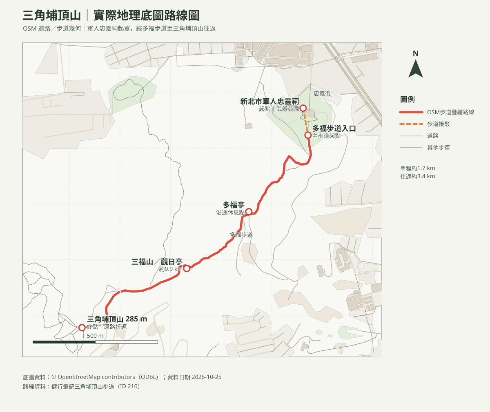

# 三角埔頂山步道｜軍人忠靈祠往返

## 名單狀態
- 路線研究筆記，未指定活動日期；出發前確認天候及交通。
- 查核日期：2026-10-25。
- 三角埔頂山又名羌子寮山，位於新北市樹林區與桃園市龜山區交界，海拔285公尺。
- [回健行口袋名單](../../README.md)

## 路線概覽
- **起終點**：新北市軍人忠靈祠（武器公園）往返。
- **路線**：忠靈祠 → 多福步道登山口 → 多福亭、同心亭 → 觀日亭／三福山 → 三角埔頂山三角點 → 原路折返。
- **距離／時間**：健行筆記列單程約1.7公里、往返約3.4公里，步行約1小時40分；屬社群路線資料，非官方測量。另有官方景點頁以約1公里概述步道，路線範圍定義不同，本頁採忠靈祠完整往返路線數據。
- **地形**：水泥路、土徑；沿途涼亭可休息，山頂有保線鐵塔及展望。

## 路線圖與分段

地圖資料來源：[OpenStreetMap contributors](https://www.openstreetmap.org/copyright)（ODbL）。

- [在 OpenStreetMap 查看實際地圖](https://www.openstreetmap.org/#map=16/25.0101/121.40525)

1. **軍人忠靈祠 → 多福步道登山口**：步行約0.2公里，約15分鐘。
2. **多福步道登山口 → 觀日亭／三福山**：步行約0.9公里，約20分鐘；經多福亭、同心亭等休憩點。
3. **三福山 → 三角埔頂山**：步行約0.6公里，約20分鐘；抵達海拔285公尺山頂後原路折返，全程約3.4公里。

以上分段時間、距離取自健行筆記路線資料；個人速度及現場路況會影響實際所需時間。

## 交通與停車
- **大眾運輸**：捷運迴龍站步行前往，或搭701、843、985、712副、橘26至「公路新村」站，再步行至忠義街及軍人忠靈祠；班次出發前查新北市公車動態。
- **自駕**：導航「新北市軍人忠靈祠」；停車空間、可停車位置與費率未由本次官方資料確認，依現場標示停放，不阻擋出入口。
- **較短登山口**：健行筆記另記載可從光明產業道路、北天真武玄殿附近登山口上山，步行約300公尺至山頂；停車與道路狀況另行確認，不列為主要路線。
- [導航至新北市軍人忠靈祠](https://www.google.com/maps/search/?api=1&query=%E6%96%B0%E5%8C%97%E5%B8%82%E8%BB%8D%E4%BA%BA%E5%BF%A0%E9%9D%88%E7%A5%A0)

## 路況重點
- 土徑雨後可能濕滑泥濘；雨天不走土徑段。
- 秋季芒花為主要季節景觀；沿步道行走，勿踩踏或採摘。

## 來源
- [健行筆記：三角埔頂山步道](https://hiking.biji.co/index.php?q=trail&act=detail&id=210)：里程、分段路線及大眾運輸資訊。查核日 2026-10-25。
- [新北市觀光旅遊網：三角埔頂山](https://newtaipei.travel/zh-tw/attractions/detail/110605)：山名、海拔及景點資訊；頁面更新日 2023-04-07。
- 出發前再查：天候、現場步道／停車標示、公共交通班次及土徑狀況。
