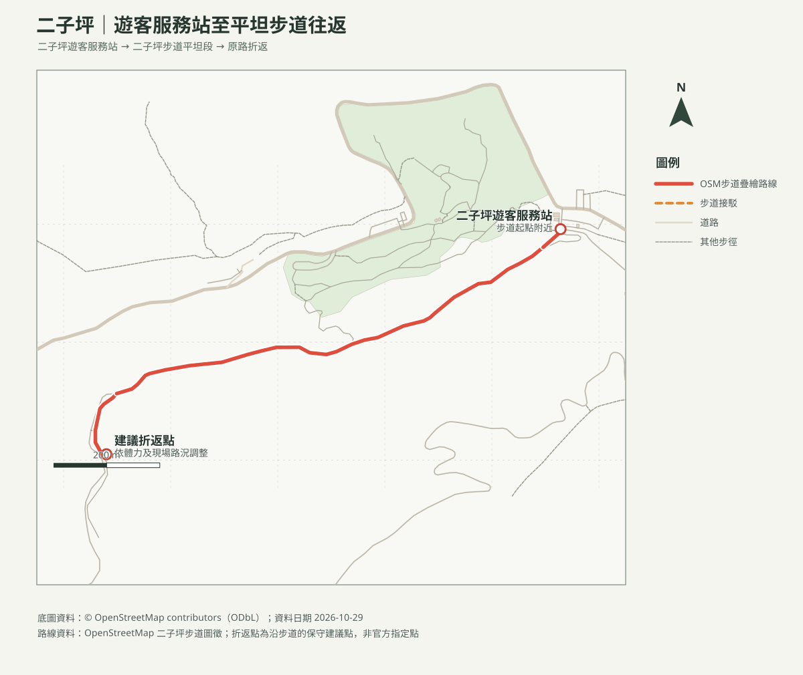

# 二子坪步道｜平坦路段親子往返

## 名單狀態
- 路線研究；查核日期：2026-10-29。成行前確認陽明山國家公園公告、天候及交通。
- [回口袋名單索引](../../README.md)

## 路線概覽
- **路線**：二子坪遊客服務站附近起步，沿平坦步道走至舒適折返點，再原路返回；可在二子坪開闊區停留觀察自然。
- **距離與時間**：本頁採短程往返，里程依 OSM 步徑幾何粗估約1.5–2公里、步行約40–60分鐘；加上休息、觀察及嬰幼兒照護可安排約2小時。無GPX實測，不列精確爬升。
- 官方介紹二子坪步道全長約2公里、路面平坦；本頁折返路線不等同官方全線長度。

## 路線地圖

路線依 OSM 已標繪步徑繪製，折返點為建議位置；非GPX實測，岔路依現場指標。

## 等高線圖（A4橫式）
- [含路線等高線 PDF](二子坪_等高線圖.pdf)；20 m網格DTM計算10 m等高距，等高距不代表地形解析度。

## 山峰方位判讀圖（A4橫式）
- [周邊山峰方位 PDF](二子坪_山頂方位圖.pdf)：觀測點設於路線中段，列出周邊OSM命名山峰的距離、真／磁方位；視線仍受地形、植被及天候影響。

## 交通與安全
- **交通**：可由陽明山公車總站搭108區公車至二子坪（班次及是否行駛以臺北市公車動態／陽明山國家公園公告為準）。自駕可導航二子坪遊客服務站周邊停車區，車位、開放時間及費率未確認，不保證有位。
- 平坦步道適合親子散步，但山區常有濃霧、降雨及低溫；地面濕滑或能見度差時縮短或取消。嬰兒車通行狀況依當日路面及官方公告確認。
- 不離開步道接近池塘或濕地；幼兒需由成人全程看顧。

## 來源與待核實
- [臺北旅遊網：二子坪](https://www.travel.taipei/zh-tw/attraction/details/249)：地點與步道特色；查核日2026-10-29。
- [陽明山國家公園](https://www.yms.gov.tw/)：出發前確認步道及交通公告。
- [OpenStreetMap contributors（ODbL）](https://www.openstreetmap.org/copyright)：路徑圖徵，地圖製作日2026-10-29。
