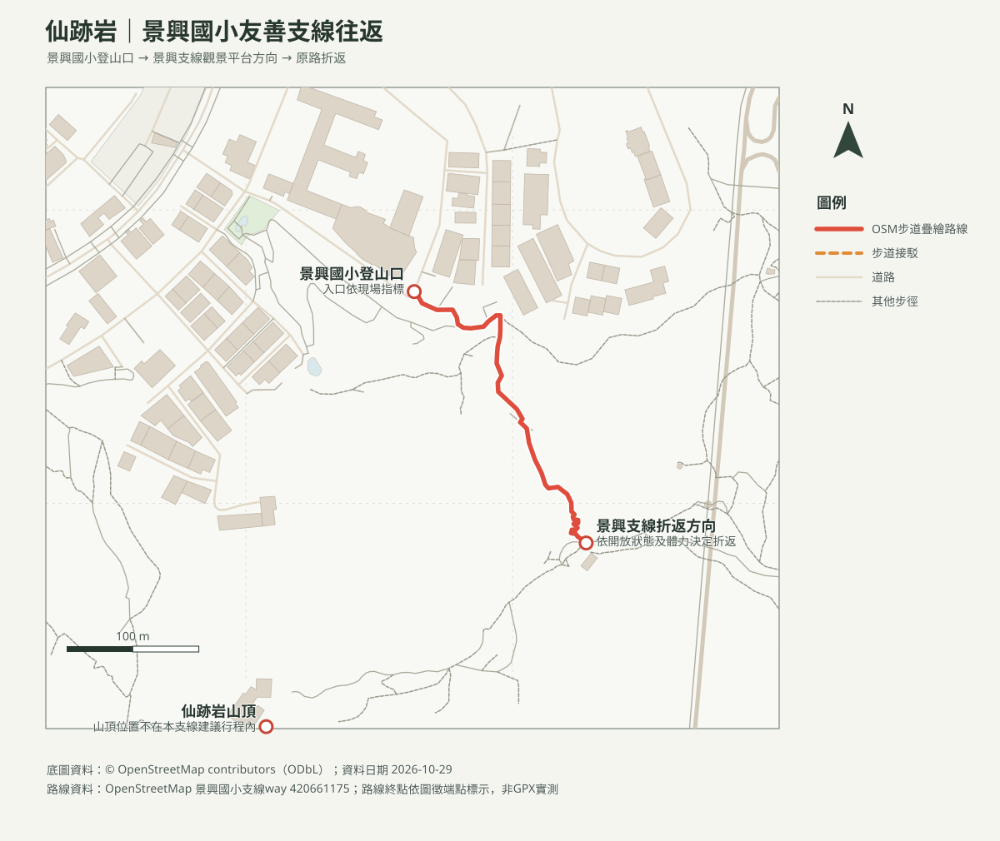

# 仙跡岩景興支線｜景興國小後方往返

## 名單狀態
- 路線研究；查核日期：2026-10-29。出發前確認臺北市大地工程處公告及現場開放狀況。
- [回口袋名單](../../README.md)

## 路線概覽
- **路線**：景興國小後方登山口 → 景興支線上行至景觀平台／合適休息點 → 原路返回。此行程不延伸至仙跡岩山頂，避免將不同支線誤認為同一條路線。
- 景興支線距捷運景美站步行約10分鐘；官方介紹稱近年改善步道及增設木作欄杆、平台、涼亭，適合家庭散步，但未提供該支線確切里程或全程時間。
- 以約1.5–2小時作含往返、停留與休息的活動窗口；步道實際長度與耗時未經GPX／導航驗證，按現場體力折返，不硬湊距離。

## 路線圖與地形圖

- [含路線等高線PDF](仙跡岩景興支線_等高線圖.pdf)：20 m DTM計算10 m等高距，並非10 m地形解析度。
- [仙跡岩周邊山峰方位判讀PDF](仙跡岩景興支線_山頂方位圖.pdf)：觀測點為仙跡岩山頂，非景興支線步行途中觀測點；真／磁方位與可見性依地形天候而異。

## 交通與安全
- 捷運松山新店線至景美站，步行約10分鐘至景興國小後方支線入口；勿進入校園，依公共道路及步道指標前往。停車費率及空位未核實，出發前查官方資訊。
- 步道有石階及上坡，雨後注意濕滑；沿途依官方推薦景興支線通行，不擅入未標示岔路。幼兒需成人背負，平台停留時遠離邊緣。

## 來源
- [臺北旅遊網：秋高氣爽登仙蹤！漫遊仙跡綠意境](https://www.travel.taipei/zh-tw/news/details/68227)：景興支線位置、交通及改善設施；查核日2026-10-29。
- [臺北旅遊網：仙跡岩親山步道](https://www.travel.taipei/zh-tw/attraction/details/186)：仙跡岩整體步道資料，非景興支線專屬里程。
- [OpenStreetMap contributors（ODbL）](https://www.openstreetmap.org/copyright)：支線圖徵；非GPX導航。
