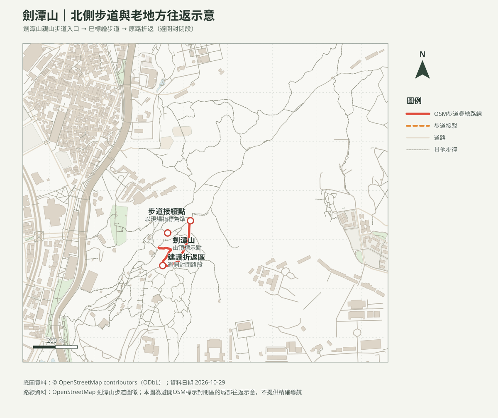

# 劍潭山親山步道｜入口短程往返

## 名單狀態
- 路線研究；查核日期：2026-10-29。**OSM資料包含「施工封閉2026/06山崩封閉」標記；出發前必須向臺北市大地工程處或現場公告核實，不得進入封閉區。**
- [回口袋名單](../../README.md)

## 路線概覽
- 臺北旅遊網資料：登山步道約2.74公里、全線約3.3公里、步行約1小時24分；本家庭以此安排約2小時含休息的短程行程，沿路遇封閉即折返。
- 目前地圖只呈現部分OSM已標繪步道、未納入標示封閉的way；實際連接與可通行性須現場核對。未持有GPX，里程及爬升不作精確宣稱。

## 路線圖及列印地圖

- [等高線圖PDF](劍潭山_等高線圖.pdf)：20 m DTM計算10 m等高距，並非10 m解析度。
- [周邊山峰方位判讀PDF](劍潭山_山頂方位圖.pdf)：標示OSM山峰距離及真／磁方位；可見度受遮蔽及天候影響。

## 交通、安全與來源
- 大眾運輸可搭捷運至劍潭站，按現場指標前往步道入口；自駕停車資訊、費率及即時空位出發前另查官方停車資訊。
- 步道石階多，背負幼兒上下階梯須保守評估；雨後濕滑、封閉、落石或負重不穩時取消或折返。
- [臺北旅遊網：劍潭山親山步道](https://www.travel.taipei/zh-tw/attraction/details/177)（里程及時間）；[臺北市大地工程處步道公告](https://geopark.gov.taipei/)。查核日2026-10-29；封閉資訊尚待官方當日確認。
- 地圖依[OpenStreetMap contributors（ODbL）](https://www.openstreetmap.org/copyright)圖徵製作；非GPX導航。
