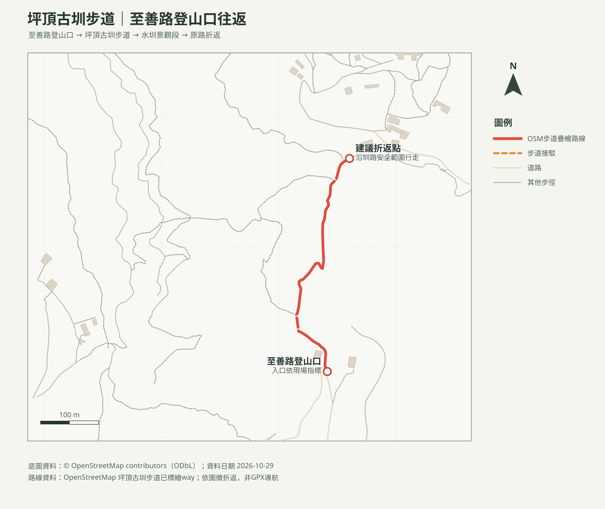

# 坪頂古圳步道｜至善路登山口往返

## 名單狀態
- 路線研究；查核日期：2026-10-29。成行前確認公告、圳路工程及公車班次。
- [回口袋名單](../../README.md)

## 路線概覽
- 臺北旅遊網資料：登山步道約1.3公里、全線約2.3公里，海拔約320至480公尺，一般步行約1小時15分。本頁採至善路側已標繪圳路段往返，步道幾何非GPX實測；不將全線官方里程直接當作本段往返距離。
- 親子停留水圳觀察及休息後可安排約2小時。水圳窄邊及跨圳處需依現場安全狀況選擇折返，不踩入水道、不跨越護欄。

## 路線圖及列印地圖

- [等高線圖PDF](坪頂古圳_等高線圖.pdf)：20 m網格DTM計算10 m等高距；等高距非地形解析度。
- [周邊山峰方位判讀PDF](坪頂古圳_山頂方位圖.pdf)：以路線附近觀測點呈現周邊OSM山峰真／磁方位，不保證山峰現地可見。

## 交通與安全
- 可搭小18公車至坪頂古圳步道附近站點；班次較少，出發前確認臺北市公車動態及時刻。停車位置、費率與空位未查核，勿停住戶出入口。
- 路線沿水圳、農地與石階通過，雨後濕滑；請走既有步徑，不碰觸水利設施、不進入農地。遇封閉、施工或強降雨立即折返。

## 來源
- [臺北旅遊網：坪頂古圳步道](https://www.travel.taipei/zh-tw/attraction/details/18)：官方距離、高度及步行時間；查核日2026-10-29。
- [臺北市大地工程處公告](https://www.geo.gov.taipei/)：步道／水圳施工消息；出發前重新確認。
- [OpenStreetMap contributors（ODbL）](https://www.openstreetmap.org/copyright)：步徑圖徵，非GPX導航。
