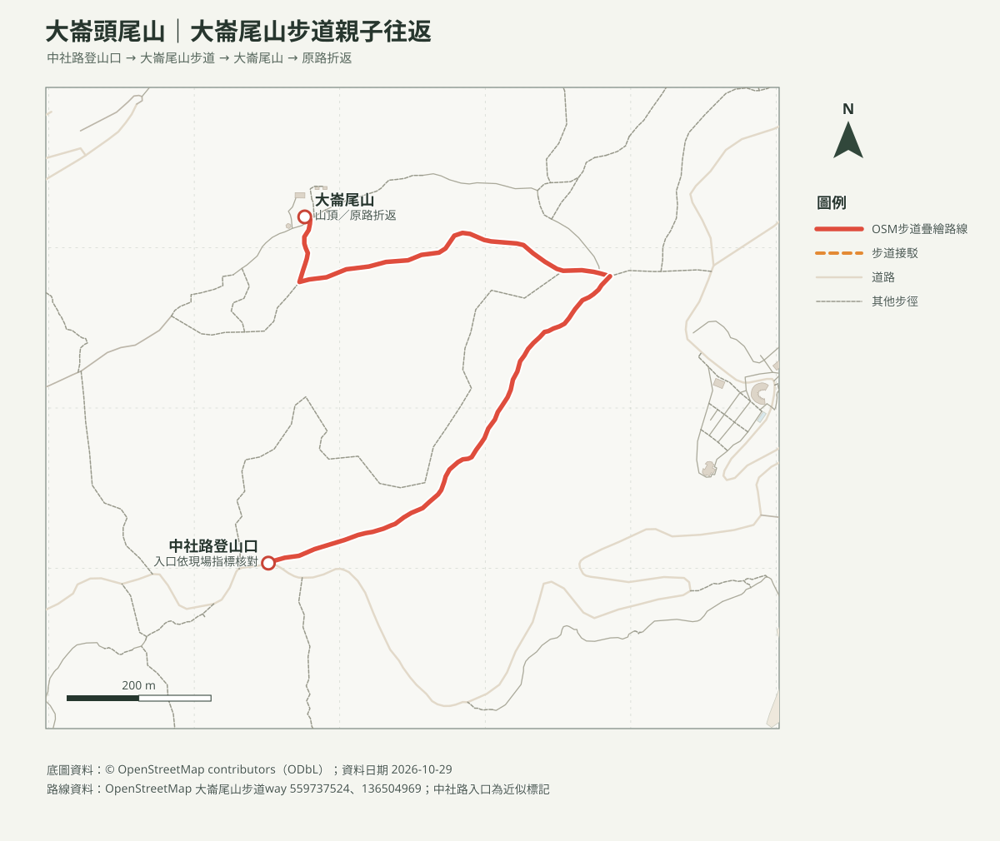

# 大崙頭尾山親山步道｜大崙尾山往返

## 名單狀態
- 路線研究；查核日期：2026-10-29。成行前重新確認步道公告、天候、交通及停車。
- 本頁採大崙尾山步道中社路側登山口往返，不與大崙頭山北面步道混為單一路線。
- [回口袋名單](../../README.md)

## 路線概覽
- **路線**：中社路側登山口 → 大崙尾山步道 → 大崙尾山山頂 → 原路折返。
- 臺北旅遊網列大崙頭尾山親山步道登山步道約3.63公里、全線約5.4公里、步行約2小時；OSM本圖依兩段已標繪步道估繪此往返支線，路線幾何／里程與官方總長度不完全等同，未持有GPX故不列精確距離或爬升。
- 本家庭應將一般步行時間保守乘以2安排，再另加停車、照護、休息及用餐時間；若時間不足，在安全路段提早折返。

## 路線圖與列印地圖

- [等高線地圖PDF](大崙頭尾山_等高線圖.pdf)：20 m DTM計算10 m等高距，10 m不代表DTM解析度。
- [大崙尾山周邊方位判讀PDF](大崙頭尾山_山頂方位圖.pdf)：周邊OSM山峰距離、真方位及磁方位；實際可見性受遮蔽與天候影響。

## 交通與安全
- 公車可查臺北市公車動態及臺北旅遊網交通資訊，確認當日可到達之站點及班次；自駕停車位置、費率與即時空位出發前另查官方資訊，車位不保證。
- 山徑林蔭、階梯及自然路面並存；雨後泥濘濕滑。遇天候不佳、封閉、負重不穩或時間不足就折返，不另接未核實支線。
- **地圖折返點為大崙尾山，不是大崙頭山**；兩山間路線與本往返行程不同。

## 來源與待核實
- [臺北旅遊網：大崙頭尾山親山步道](https://www.travel.taipei/zh-tw/attraction/details/176)：官方路徑長度及一般步行時間；查核日2026-10-29。
- [臺北市大地工程處步道公告](https://geopark.gov.taipei/)：出發前確認開放及施工資訊。
- [OpenStreetMap contributors（ODbL）](https://www.openstreetmap.org/copyright)：步道圖徵；路線非GPX實測。
