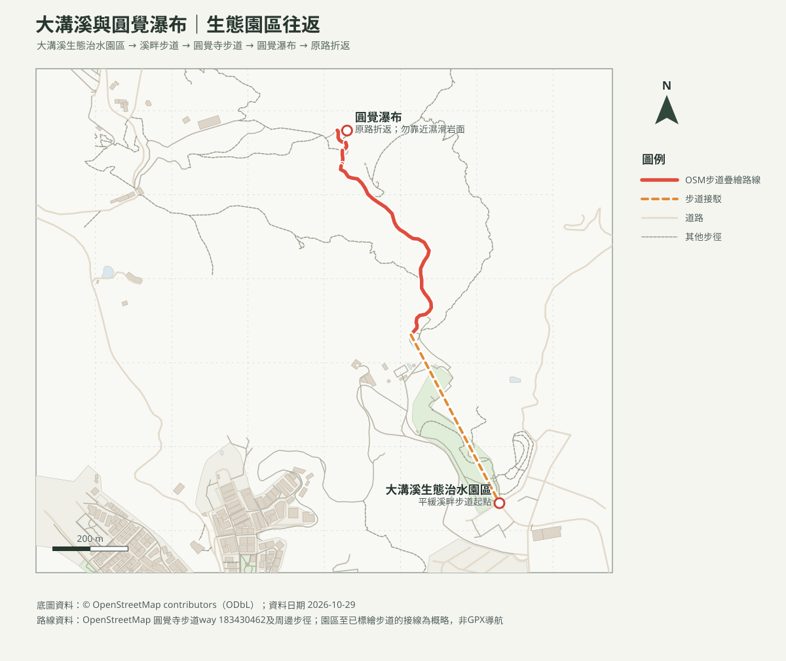

# 大溝溪生態步道與圓覺瀑布｜親子往返

## 名單狀態
- 路線研究；查核日期：2026-10-29。出發前重查步道公告、降雨及溪水狀況。
- [回口袋名單](../../README.md)

## 路線概覽
- **路線**：大溝溪生態治水園區 → 溪畔平緩步道 → 圓覺寺步道 → 圓覺瀑布 → 原路折返。
- 臺北旅遊網介紹大溝溪溪畔步道平緩，圓覺寺步道通往瀑布，適合親子同行。本頁建議將步行、瀑布觀景、休息與照護合計安排約2小時；未取得該往返組合的GPX，里程及累積爬升不作精確宣稱。
- 地圖上的溪畔園區至已標繪圓覺寺步道路段以概略線連接；此段依官方介紹及圖資判讀，請依現場指標核對。

## 路線圖與地形圖

- [等高線圖PDF](大溝溪圓覺瀑布_等高線圖.pdf)：20 m網格DTM計算10 m等高距，非10 m解析度。
- [圓覺瀑布周邊方位判讀PDF](大溝溪圓覺瀑布_山頂方位圖.pdf)：觀測點為瀑布附近，不代表有安全視野平台；周邊山峰名稱依OSM，能否看見仍受地形與天候影響。

## 交通與安全
- 捷運文湖線大湖公園站步行約700公尺至大溝溪生態治水園區；公車可至捷運大湖公園站或大湖國小，再步行前往。班次出發前查詢。
- 園區兼具滯洪功能，豪雨時溪水可能快速上升；有雷雨、豪雨或溪水混濁上漲時取消溪畔行程。平時也不讓幼兒涉水，瀑布岩面與溪石濕滑，勿攀爬或接近落差。
- 嬰兒車可否通行依園區及當日路面確認；至山徑階梯後需背負幼兒並評估安全負重。

## 來源
- [臺北旅遊網：圓覺瀑布](https://www.travel.taipei/zh-tw/attraction/details/2272)：溪畔步道、交通與親子步行特色。
- [臺北旅遊網：微涼秋日野餐趣，探尋圓覺瀑布](https://www.travel.taipei/zh-tw/news/details/67952)：發布2026-09-29，步道及交通資訊。
- [臺北市大地工程處](https://www.geo.gov.taipei/)：出發前確認封閉及施工公告。
- [OpenStreetMap contributors（ODbL）](https://www.openstreetmap.org/copyright)：路徑圖徵；非GPX導航。
