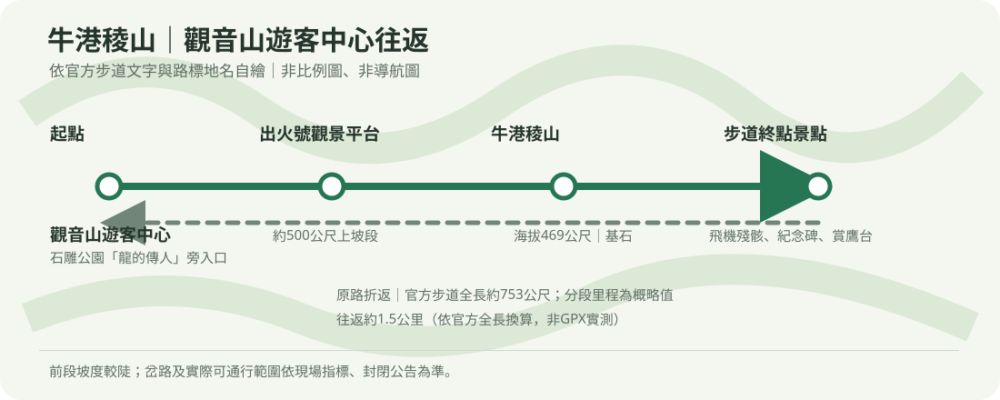

# 牛港稜山步道｜觀音山遊客中心往返

## 名單狀態
- 路線研究筆記，未指定活動日期；成行前重新確認步道、天候與停車狀況。
- 查核日期：2026-10-25。
- [回健行口袋名單](../../README.md)

## 路線概覽
- **起終點**：觀音山遊客中心（管理站）／石雕公園旁步道入口。
- **路線**：觀音山遊客中心 → 出火號觀景平台 → 牛港稜山（469公尺）→ 飛機殘骸、紀念碑與賞鷹台 → 原路折返。
- **步道長度**：官方景區步道介紹記載全長約753公尺；往返約1.5公里。官方分段描述為入口至出火號約500公尺、鞍部至終點約300公尺，均為概略值，總長與分段合計略有差異；未取得本次GPX，非精測距離。
- **步道型態**：短程往返；入口至出火號前段較陡，稜線後段較緩。步道含石板、鋼構棧橋及碎石路面。
- **時間**：一般步行往返約1小時量級（依官方分段步行時間整理，含基本往返，不含停留）；親子行程另預留休息、餵食、換尿布與安撫時間。路況、體能及停留會影響實際時間。

## 路線圖與分段

本圖為依官方步道文字重新繪製的路線關係示意，非比例圖、非導航圖。岔路依現場指標核對。

## 等高線地圖（A4 橫式）
- [含路線 PDF（比例尺 1:3,000）](牛港稜山_等高線圖.pdf)
- 由 20 m 網格 DTM 計算 10 m 等高距；等高距不代表地形資料解析度。路線沿 OSM 步道圖徵繪製，虛線接線為概略，出發前依現場指標核對。

## 山頂方位判讀圖（A4 橫式）
- [周邊山峰方位 PDF（比例尺 1:50,000）](牛港稜山_山頂方位圖.pdf)
- 表列真方位與磁方位、距離；山峰名稱依 OSM，能否看見仍受稜線、植被及天候影響。

1. **觀音山遊客中心 → 石雕公園步道口**：由遊客中心右側、石雕「龍的傳人」附近進入步道。
2. **步道口 → 出火號觀景平台**：前段約500公尺為較陡上坡，放慢腳步、在安全處休息。
3. **出火號 → 牛港稜山 → 步道終點**：稜線轉為緩坡，經牛港稜山基點及飛機殘骸、紀念碑、賞鷹台一帶；看完後原路返回。遠端路徑依官方現場設施及標示辨認。

## 停車與交通
- **自駕**：導航至「觀音山遊客中心」，地址新北市五股區凌雲路三段130號。入口旁設有停車場；停車費率、格位及營運細節出發前依現場公告確認。假日車位及道路車流依實際狀況而異。
- **大眾運輸**：可由捷運蘆洲站轉乘橘20至觀音山遊客中心（班次及假日路線依新北市公車動態確認）；由「凌雲寺」下車則需步行約20分鐘至遊客中心。
- [導航至觀音山遊客中心](https://www.google.com/maps/search/?api=1&query=%E8%A7%80%E9%9F%B3%E5%B1%B1%E9%81%8A%E5%AE%A2%E4%B8%AD%E5%BF%83)

## 親子與安全
- 步道短但前段陡，後段有碎石路。幼兒不以自行走完全程為預設；使用背巾／背架須符合產品規範，並評估成人負重及上下坡能力。不可使用嬰兒車行走登山路段。
- 雨天或雨後石板、棧橋、碎石可能濕滑；遇雷雨、強風、步道封閉或能見度差，取消或折返，不跨越封鎖線。
- 觀音山為猛禽遷徙及觀察區，請保持安靜、不追逐或餵食野生動物；不攀爬護欄及殘骸設施。
- 另有支線可接四角亭、民義路一帶；回到不同道路後不再是遊客中心原路往返。沒有接駁安排時走主線原路返回。
- 實際安排時再依活動日期評估幼兒年齡、裝備及照護需求；本目的地筆記不固定年齡快照。

## 資訊與來源
- [北海岸及觀音山國家風景區管理處：牛港稜步道](https://www.northguan-nsa.gov.tw/user/article.aspx?lang=1&sno=04006755)：入口、步道長度、路面、出火號、觀景平台與全年開放資訊。查核日 2026-10-25。
- [交通部觀光署觀光多媒體開放資料：牛港稜步道（支線）](https://media.taiwan.net.tw/en-us/portal/travel/details/trail_a15011000h_000101)：資料標示步道支線長度355公尺、海拔472公尺及營運狀態正常；與景區遊憩步道頁記載753公尺的範圍不同，本文主線長度採景區步道介紹的端到端描述。資料更新日 2026-08-15。
- [健行筆記：牛港稜山登山步道](https://hiking.biji.co/index.php?q=trail&act=detail&id=111)：觀音山遊客中心起登路線及牛港稜山469公尺基點參考；第三方登山資料，路口仍以官方及現場指標為準。
- 行前確認：步道及園區公告、天候、遊客中心開放時間、停車費率／空位與橘20班次。
