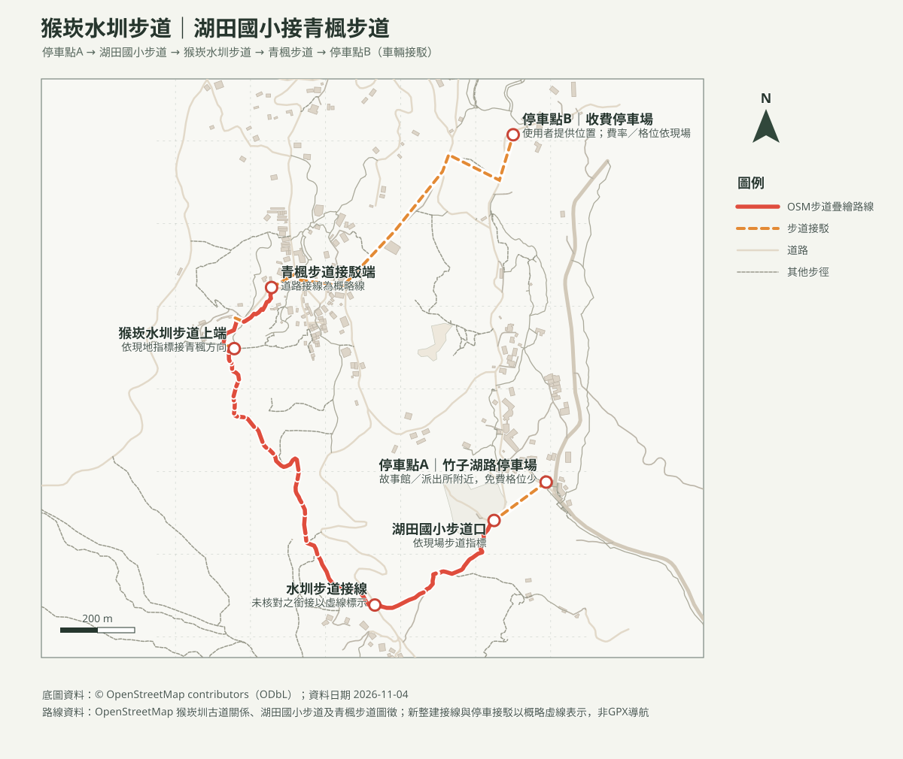

# 猴崁水圳步道｜湖田國小步道接青楓步道

## 名單狀態
- 路線研究；查核日期：2026-11-04。出發前重新確認施工、封閉、天候及停車場現況。
- [回口袋名單索引](../../README.md)

## 路線概覽
- **建議串聯**：蓬萊米故事館／湖田國小附近起步 → 湖田國小步道（猴崁段）→ 猴崁水圳步道 → 青楓步道 → 竹子湖道路接駁端。此路線圖按 OSM 已標繪步道疊繪；整建後的新步道與停車接線有概略虛線，未持有本路線 GPX，請依現場標示核對。
- **里程／時間**：官方公告未提供這組串聯路線的整體距離與時間。第三方路線記錄有約4.78公里的不同走法，但不是本圖GPX。此三段串聯先以約3–5公里、一般步行約2–3小時作粗估；帶幼兒時按步行估時乘以2，再加休息與照護，可能需4–6小時。若希望短程，可在完成猴崁水圳步道後折返，不必延伸青楓步道。
- **地形**：猴崁水圳步道已增設棧橋、護欄及跨溪繩索吊橋；湖田國小步道含石階，青楓步道有木棧道／階梯。非嬰兒車路線；雨後石階、青苔、木棧道及水圳邊可能濕滑。

## 地理路線圖與列印圖

路線幾何取自 OSM 已標繪步道；虛線表示 OSM 接線未完整或停車接駁未經現場核實，不是GPS軌跡，也不能作精確導航。

### 等高線圖（A4橫式）
- [含路線等高線PDF](猴崁水圳步道_等高線圖.pdf)：由內政部20 m網格DTM計算10 m等高距；10 m是等高距，不代表地形解析度。

### 周邊山峰方位判讀圖（A4橫式）
- [步道附近方位判讀PDF](猴崁水圳步道_山頂方位圖.pdf)：觀測點在步道上端附近，並非正式觀景台；山峰真／磁方位及可見性受地形、植被及天候影響。

## 停車與車手接駁（依使用者提供位置）
1. **優先：**[竹子湖路停車場／蓬萊米故事館附近](https://maps.app.goo.gl/3tyHi4Wx8rLuGvme8)。陽明山國家公園停車資訊列竹子湖停車場在竹子湖入口轉角、派出所對面，小客車約9格、免費；本次以地圖位置對照，抵達仍須核對現場標誌。格位少、不保證有位。
2. **滿位備案：**[使用者指定的收費停車場](https://maps.app.goo.gl/SxW97mFHdpLY897P8)。Google地圖標示為收費停車場；營運者、費率、格位與開放狀況未由官方資料核實，依現場公告，不假設一定有位。
3. 兩個地圖圖釘直線相距約0.95公里（座標粗估）；可按使用者構想由「車手」步行／慢跑接駁，但**實際合法人行路線可能更長，且目前未核實全程有人行道**。先用步行導航確認連續安全路徑；不可在車道或無安全路肩處跑步。接駁時由另一位成人全程陪同幼兒，不能讓幼兒單獨等候。
4. 若停車點B滿位或無安全步行接駁，改搭公車、協調不同接駁，或退回停車點A做短程往返；不要臨停、違停或為接車趕路。活動日即時空位及費率不保證。

## 大眾運輸
- 臺北市大地工程處建議由捷運北投站轉小9至湖田國小站或竹子湖派出所站；亦可依出發方向查小8及其他現行公車。班次、停靠站及山區交通管制以出發日公車動態為準。
- [臺北市公車動態](https://ebus.gov.taipei/)

## 親子與安全提醒
- 猴崁水圳步道有窄幅水圳邊、階梯、棧道及跨溪繩索橋；幼兒須由成人背負並全程看顧，不讓幼兒自行靠水邊、不涉水、不攀欄杆。背巾／背架須符合產品規範，成人需能安全負重通過狹窄及濕滑段。
- 連日降雨、溪水暴漲、吊橋或步道封閉、苔滑或能見度差時取消／折返。出發前一日及當日確認北市大地處與陽明山國家公園公告。

## 來源與待核實
- [臺北市大地工程處：陽明山新景點開箱！邀您漫遊竹子湖猴崁水圳步道](https://www.geo.gov.taipei/News_Content.aspx?n=23285747C0511EC4&s=07113FAA5F397EA0&sms=72544237BBE4C5F6)：步道設施、湖田社區串聯及交通資訊；發布2026-06-26，查核2026-11-04。
- [陽明山國家公園：停車場一覽](https://www.ymsnp.gov.tw/ch/listicle/parking-lots-list)：竹子湖停車場格位／費用資訊；出發前以現場公告為準。
- [健行筆記：猴崁水圳步道 GPX/路線紀錄](https://hiking.biji.co/index.php?q=trail&act=info&review_id=47804)：第三方路線參考，不下載或採用其軌跡作本圖；不同串聯走法里程不同。
- [OpenStreetMap contributors（ODbL）](https://www.openstreetmap.org/copyright)：湖田國小、猴崁古道及青楓步道圖徵；地圖製作日2026-11-04。
