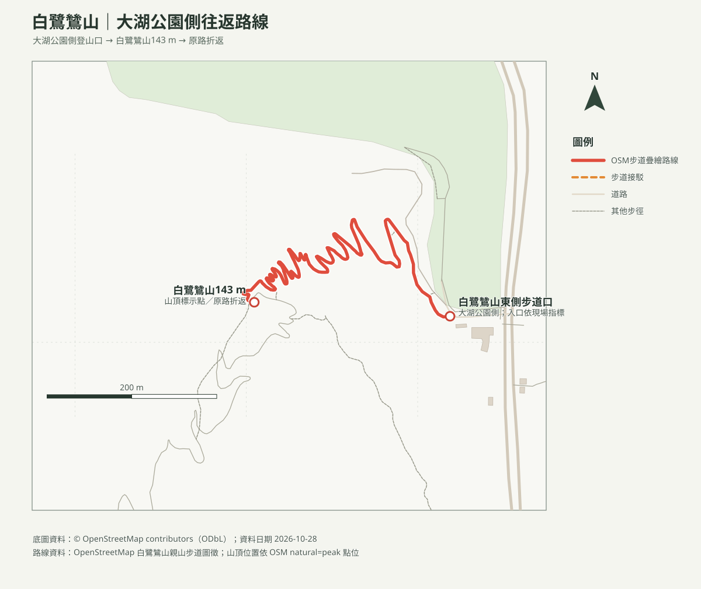
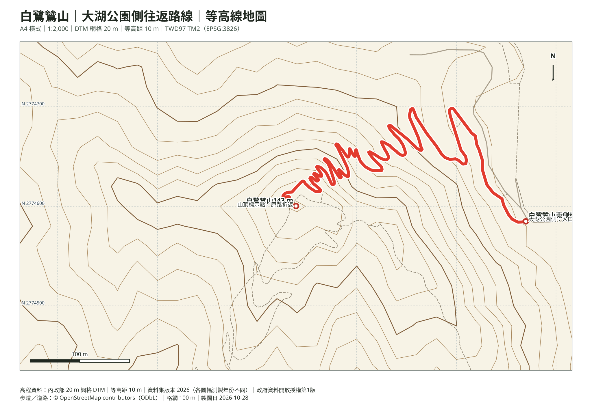

# 白鷺鷥山親山步道｜大湖公園側往返

## 名單狀態
- 路線研究；查核日期：2026-10-28。成行前重查步道公告、天候與停車資訊。
- 白鷺鷥山又稱白鷺山、埤頭尖山，海拔約143公尺；步道也稱「五十彎步道」。
- [回健行口袋名單](../../README.md)

## 路線概覽
- **起終點**：白鷺鷥山東側步道口（大湖公園側）往返。
- **路線**：沿 OSM 已標繪的白鷺鷥山親山步道上行至山頂標示點，再原路折返。官方介紹的全線約2.1公里，是東、西登山口間的步道；本頁採大湖公園側登頂折返，非全線單程。
- **本圖里程**：依 OSM 步道幾何，登山口至山頂約0.84公里、往返約1.7公里，屬地圖幾何粗估，未經 GPX 或實地測距；不列累積爬升精確值。
- **路況**：步道蜿蜒、轉彎多，沿線石階及林蔭路段；山頂海拔約143公尺。雨後石階濕滑，依現場指標慢行。
- 本路線未持有使用者提供的 GPX；圖上以已標繪步道呈現，不應取代現場指標或導航。

## 路線圖

路線幾何來自 OpenStreetMap 已標繪步道；步道口與山頂以 OSM 地名點標示。底圖未經本次 GPX 核對，岔路依現場指標。

## 等高線地圖（A4 橫式）

- [含路線 PDF（比例尺 1:2,000）](白鷺鷥山_等高線圖.pdf)
- 由內政部20 m網格DTM計算10 m等高距；10 m是等高距，不代表地形解析度為10 m。

## 山頂方位判讀圖（A4 橫式）

- [周邊山峰方位 PDF（比例尺 1:50,000）](白鷺鷥山_山頂方位圖.pdf)
- 以白鷺鷥山山頂為觀測點，編號對照周邊 OSM 登錄山峰、距離、真方位與磁方位。峰名不保證現地可見；仍受地形遮蔽、植被及天候影響。

## 交通與停車
- **大眾運輸**：搭臺北捷運文湖線至大湖公園站，依出口2及現場「白鷺鷥山」指標步行前往。臺北捷運資料列車站至步道約1公里／15分鐘，實際依入口與步行速度而異。
- **自駕**：可使用大湖公園地下停車場（成功路五段7號地下室）；臺北市停車資訊頁查核日2026-10-28列24小時營業、221格，小型車20元／時、半小時計費。即時剩餘車位會變動，不保證抵達時有位。
- 登山口在大湖公園東南側成功路五段一帶；依合法人行動線步行到入口，不將車停在登山口巷弄或住戶出入口。
- [大湖公園地下停車場即時資訊](https://atis.taipei.gov.tw/aspx/park/parkF.aspx?lang=zh-Hant-TW&region=%E5%85%A7%E6%B9%96%E5%8D%80&sn=TPE0888)
- [導航至大湖公園](https://www.google.com/maps/search/?api=1&query=%E5%A4%A7%E6%B9%96%E5%85%AC%E5%9C%92%E5%8F%B0%E5%8C%97)

## 親子與安全
- 連續石階、五十彎路段及濕滑時不適合嬰兒車；幼兒由成人背負，須符合背巾／背架產品規範並評估成人上下階梯的平衡與負重。
- 雨天或雨後石階可能濕滑；遇雷雨、步道封閉、落枝或身體不適，折返或取消，不走未標示支線。
- 安排實際行程時，再依活動日期評估幼兒年齡、裝備、休息與照護需求；本目的地筆記不保存年齡快照。

## 來源與待核實
- [臺北市內湖區公所：白鷺山五十彎步道](https://nhdo.gov.taipei/ct.asp?xItem=46133&CtNode=3741&mp=124051)：山名別稱、海拔、全線長度及東西登山口。頁面內容較早，查核日2026-10-28；現況仍看現場公告。
- [臺北旅遊網：五指山系白鷺鷥山、康樂山、明舉山親山步道](https://www.travel.taipei/zh-tw/attraction/details/180)：步道特色及區域關聯。
- [臺北捷運：大湖公園站](https://web.metro.taipei/c/stationstory/027/027.html)：車站至白鷺鷥山步道約1公里／15分鐘。
- [臺北市停車資訊：大湖公園地下停車場](https://atis.taipei.gov.tw/aspx/park/parkF.aspx?lang=zh-Hant-TW&region=%E5%85%A7%E6%B9%96%E5%8D%80&sn=TPE0888)：格位、營業與費率；查核日2026-10-28，即時空位不保證。
- [OpenStreetMap contributors（ODbL）](https://www.openstreetmap.org/copyright)：路線圖徵及山峰標記。地圖製作日2026-10-28。
