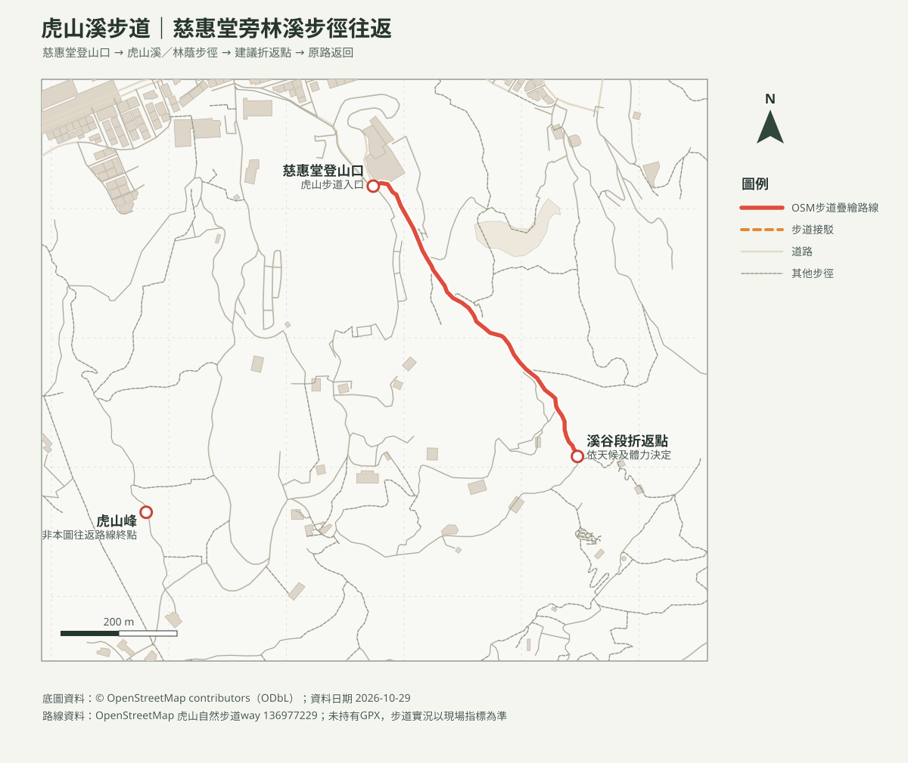

# 虎山溪步道｜慈惠堂旁親子往返

## 名單狀態
- 路線研究；查核日期：2026-10-29。出發前確認臺北市大地工程處公告、雨量及溪流水位。
- [回口袋名單](../../README.md)

## 路線概覽
- 本頁選擇松山慈惠堂登山口沿虎山自然步道／溪谷方向往返，不納入虎山峰上方繩索陡降段。安排約1.5–2小時，可於溪畔休息觀察；本圖所示OSM步道長度不等同官方整條親山步道距離。
- 臺北旅遊網列虎山親山步道登山步道約2.5公里、全線約3.9公里；本頁短線按OSM圖徵規劃，未持有GPX，不列精確里程及爬升。

## 路線圖與列印地圖

- [含路線等高線PDF](虎山溪步道_等高線圖.pdf)：20 m網格DTM計算10 m等高距，非10 m解析度。
- [虎山峰周邊方位判讀PDF](虎山溪步道_山頂方位圖.pdf)：觀測點為虎山峰，不是溪谷路段；真／磁方位及實際可見性受地形、植被和天候影響。

## 交通與親子安全
- 捷運後山埤站步行約20分鐘至慈惠堂登山口；或搭公車至福德國小，再步行約10分鐘。公車路線及班次依臺北市公車動態確認。
- 溪谷石階與木棧道雨後濕滑；暴雨、雷雨或水位上升時不進溪谷。不可讓幼兒自行靠近水邊或涉水，勿在急流／深潭戲水。
- 其他虎山環線含陡坡或繩索路段，不屬本建議短線；若當日指標要求改道或封閉，依現場公告折返。

## 來源
- [臺北旅遊網：虎山親山步道](https://www.travel.taipei/zh-tw/attraction/details/184)：步道特色及路徑長度。
- [臺北旅遊網：秋日雅行，首選虎山溪](https://www.travel.taipei/zh-tw/news/details/66278)：交通方式及步道特色（發布2025-11-18）。
- [OpenStreetMap contributors（ODbL）](https://www.openstreetmap.org/copyright)：步徑幾何，非GPX導航。
