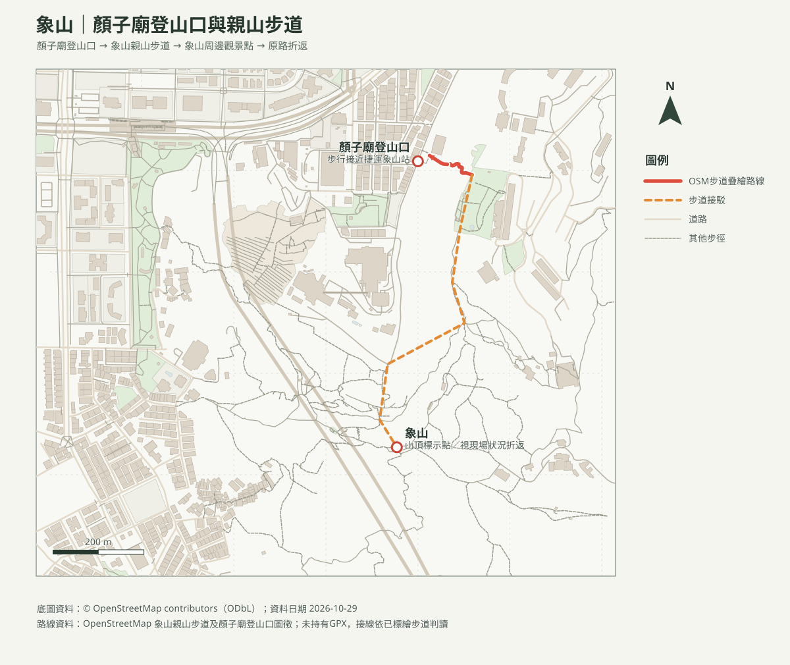

# 象山親山步道｜顏子廟登山口往返

## 名單狀態
- 路線研究；查核日期：2026-10-29。成行前確認臺北市步道公告、天候及人潮。
- [回口袋名單](../../README.md)

## 路線概覽
- 官方資料：步道全長約1.45公里、全程約1小時40分、海拔約183公尺。本頁建議顏子廟登山口往返，約1.5–2小時一般步行與觀景時間；家庭實際排程另增加休息及照護時間。
- 本圖由OSM已標繪步道及登山口點位整理；缺少連續way／GPX核對的路段以虛線概略接線表示，不作精確導航。里程及累積爬升未獨立實測。

## 路線圖與地形圖

- [等高線圖PDF](象山_等高線圖.pdf)：20 m DTM計算10 m等高距，非10 m地形解析度。
- [山頂方位判讀PDF](象山_山頂方位圖.pdf)：含周邊山峰距離、真／磁方位；視線可能受地形、植被及天候影響。

## 交通與親子安全
- 捷運淡水信義線至象山站，按指標步行至登山口；自駕停車費率及車位依臺北市即時停車資訊與現場公告，不保證有位。
- 石階、砂岩地形及熱門觀景點人潮是主要風險；雨後濕滑、靠近岩緣或攀爬巨石不適合背負幼兒停留，勿為拍照離開步道。
- [臺北旅遊網：象山親山步道](https://www.travel.taipei/zh-tw/attraction/details/185)（里程、步行時間與路線特色）；[OpenStreetMap contributors（ODbL）](https://www.openstreetmap.org/copyright)。查核日2026-10-29。
