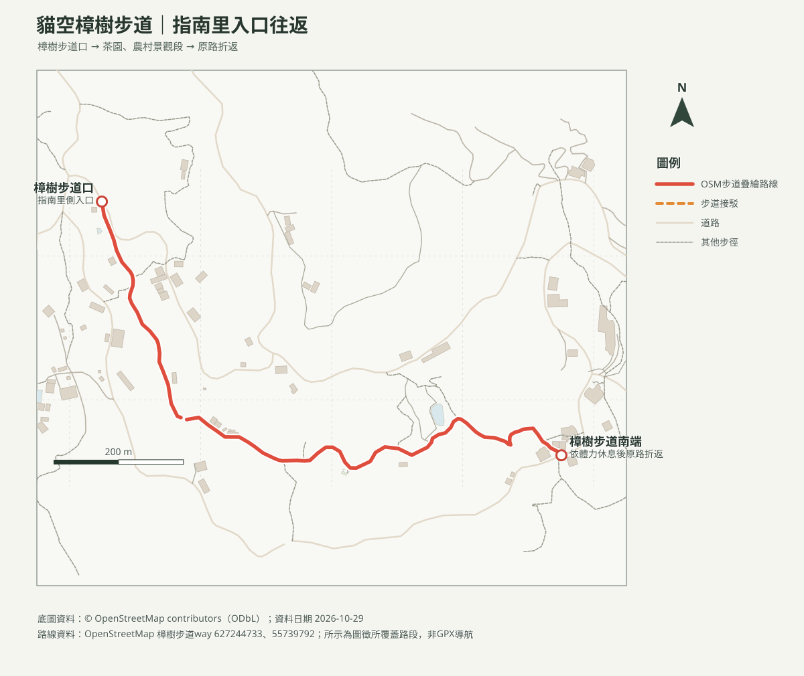

# 貓空樟樹步道｜平緩親子往返

## 名單狀態
- 路線研究；查核日期：2026-10-29。成行前確認纜車／公車營運及步道公告。
- [回口袋名單](../../README.md)

## 路線概覽
- 樟樹步道為貓空農村景觀步道，官方介紹其路線平緩、適合各年齡層；周邊有茶園、梯田、炭窯、穀倉等景點，也可銜接較長的樟湖步道。
- 本頁僅規劃指南里側已標繪的樟樹步道路段原路往返；官方資料稱樟樹步道全長約1.5公里，地圖未完整涵蓋全線，未持有GPX，里程及爬升不列精確值。安排約1.5–2小時可包含觀景、休息與照護時間。

## 路線圖及列印地圖

- [等高線圖PDF](貓空樟樹步道_等高線圖.pdf)：20 m網格DTM計算10 m等高距；非10 m地形解析度。
- [周邊山峰方位判讀PDF](貓空樟樹步道_山頂方位圖.pdf)：觀測點為步道南側，列示周邊OSM山峰真／磁方位；地形遮蔽及天候會影響視線。

## 交通與安全
- 可搭貓空纜車至貓空站，依指南路三段38巷及現場步道標誌步行前往；亦可查貓空地區公車。纜車與公車班次、營運狀況出發前重查。
- 步道平緩但部分地面可能濕滑；遇雨或農務作業時依現場指示通行，不進入茶園、私有農地或未標示支線。若想延伸樟湖步道，另行確認時間與路況，不自動視為同一路線。

## 來源
- [臺北旅遊網：貓空樟樹步道](https://www.travel.taipei/zh-tw/attraction/details/2168)：步道特色。
- [貓空商圈：樟樹／樟湖步道介紹](https://maokong.travel.taipei/zh-tw/visit)：環狀步道連接與地區資訊。
- [OpenStreetMap contributors（ODbL）](https://www.openstreetmap.org/copyright)：地理圖徵；地圖為OSM資料所覆蓋路段，非GPX實測。
