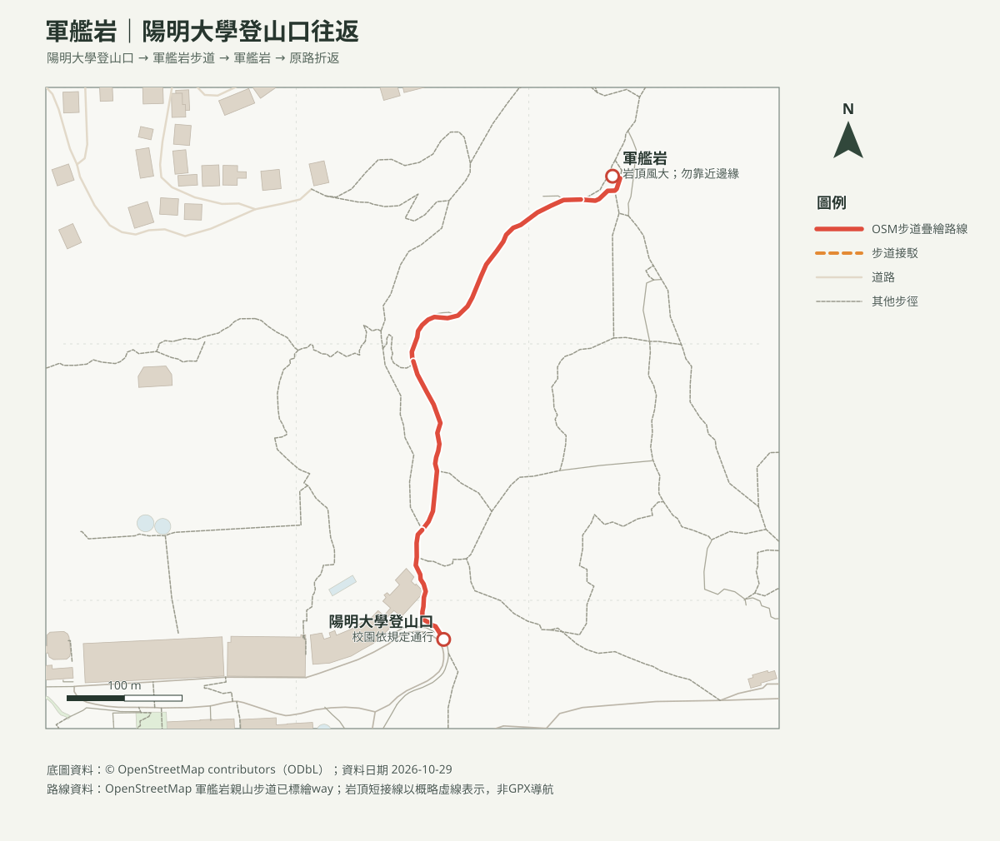

# 軍艦岩親山步道｜陽明大學端往返

## 名單狀態
- 路線研究；查核日期：2026-10-29。出發前核實臺北市大地工程處公告、校園通行規定與天候。
- [回口袋名單](../../README.md)

## 路線概覽
- 臺北旅遊網列登山步道約3公里、海拔185.6公尺、一般步行約2小時7分。本頁建議陽明大學登山口經親山步道至岩頂原路往返；家有幼兒時宜放寬時間並依負重狀況提早折返。
- 路線沿OSM步道圖徵疊繪；山頂岩面短接線為概略標示，未持有GPX，里程及爬升不列精確值。

## 路線圖與列印地圖

- [等高線圖PDF](軍艦岩_等高線圖.pdf)：20 m網格DTM計算10 m等高距，並非10 m地形解析度。
- [山頂方位判讀PDF](軍艦岩_山頂方位圖.pdf)：周邊山峰距離、真／磁方位；實際視野受地形與天候影響。

## 交通與安全
- 可由捷運唭哩岸站或石牌站步行至校園端入口，依現場指標及校方規定通行。停車費率、車位及即時空位未核實，出發前另查官方資訊。
- **山頂裸露砂岩易受風、雨影響**；濕滑、強風、雷雨時不登岩頂。幼兒全程由成人照看，不攀爬岩緣；背負幼兒者先評估狹窄石階及岩面轉身空間，無把握即在林下步道折返。
- 不進入沿線護育或封閉區域。

## 來源
- [臺北旅遊網：軍艦岩親山步道](https://www.travel.taipei/zh-tw/attraction/details/16)：步道距離、海拔及一般步行時間；查核日2026-10-29。
- [臺北市大地工程處：軍艦岩步道資訊](https://www.geo.gov.taipei/)；[OpenStreetMap contributors（ODbL）](https://www.openstreetmap.org/copyright)。路線非GPX實測。
