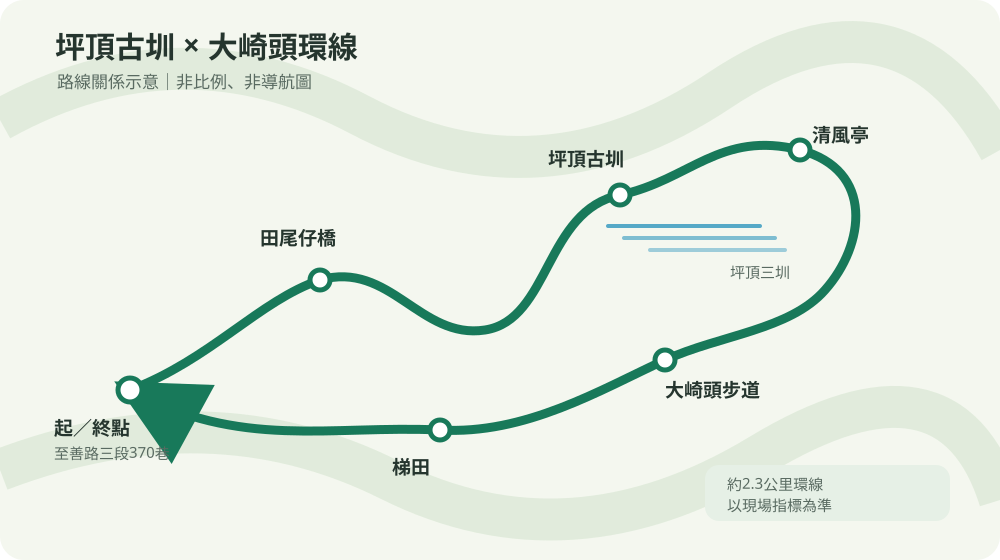

# 2026/11/01（日）坪頂古圳健行

## 行程重點
- **集合／出發**：自行開車，集合地點由領隊通知
- **路線**：坪頂古圳步道＋大崎頭步道環線
- **路線長度**：約2.3公里；步行約1小時12分至1小時22分。家庭行程請預留約3–4小時，含休息與照護時間。
- **同行**：兩位成人、一位幼兒。
- **目標**：走訪古圳與梯田景觀，完成短環線；不延伸至擎天崗或瑪礁古道。

## 路線安排

本圖為專案自行繪製的路線關係示意，非比例圖、非導航圖；路線方向請依現場指標確認。

1. 至善路三段370巷登山口起登。
2. 經田尾仔橋，沿步道經登峰圳、坪頂新圳及坪頂古圳前往清風亭。
3. 由清風亭接大崎頭步道，經梯田景觀回至善路，再步行返回停車處。

路線包含石階及陡坡，請穿防滑鞋、依現場指標行走。幼兒由成人以符合使用規範的背巾／背架背負；不使用嬰兒車、不涉水、不踩溪石。

## 交通與停車
- 自行開車至至善路三段尾端，於至善路三段336巷路口附近停車，再步行前往登山口；依現場標誌停放，不占用住戶出入口或阻礙通行。
- [停車點地圖（Google Maps）](https://maps.app.goo.gl/JiGxB3g3jxTM6xvKA)；不需把車開進370巷。
- 大眾運輸可由捷運劍潭站轉乘小18前往坪頂古圳步道附近，出發前確認當日班次與站點。

## 行程節奏
- **07:30前出發**：走完整環線，沿途休息；午餐自備。
- **07:30–09:00離開**：走環線，縮短停留；若路面濕滑，清風亭前折返。
- **09:00–10:30離開**：走古圳步道安全路段後原路折返，不走大崎頭陡段。
- **10:30後離開**：改室內活動。

最晚15:00開始回程、15:30前離開步道。遇雨勢增強、雷雨、路面濕滑或隊員身體不適，立即縮短路線或折返。

## 裝備與餐食
- 防滑健行鞋、飲水、簡便午餐、雨具、幼兒背負裝備及個人藥品。
- 午餐自備；安排於安全且不妨礙通行處休息。

## 出發前確認
- 查詢當日天氣及步道公告；確認道路交通與停車安排。
- 路線約2.3公里資料依公開環線導覽，現場以步道指標為準。

## 參考資料
- [臺北旅遊網：坪頂古圳親山步道](https://www.travel.taipei/zh-tw/attraction/details/18)
- [臺北市政府工務局大地工程處步道資訊](https://hiking.taipei/)
- [臺北市政府：古道．水圳．透心涼](https://www.gov.taipei/News_Content.aspx?n=F0DDAF49B89E9413&s=4A5FDB209D142043&sms=72544237BBE4C5F6)
