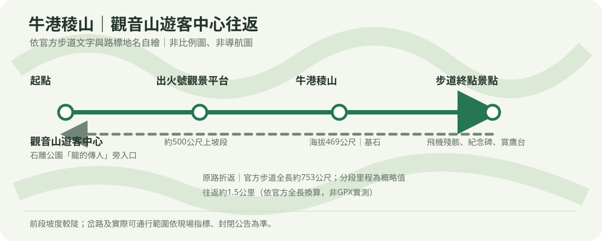
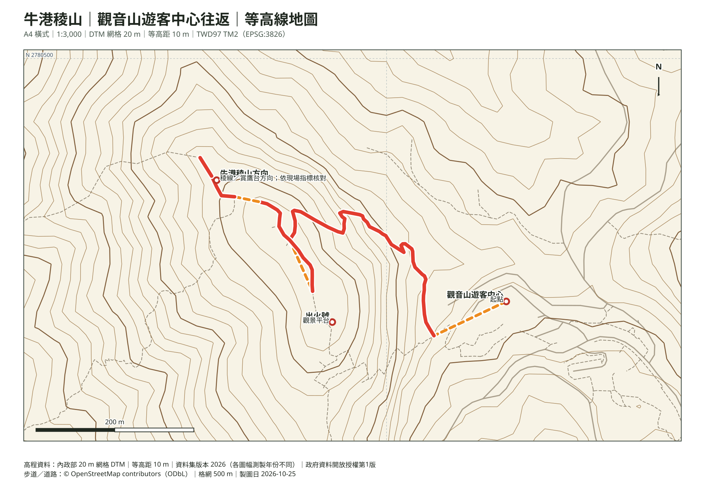

# 2026/11/08（日）牛港稜山步道｜09:00集合（條件式草案）

> **目前不可視為已開放：** 北觀處公告指出牛港稜「支線步道」100 m及150 m處發生土石崩落並先行封閉（公告最後更新2026-05-15）。截至2026-11-02，未查到該封閉段已解除的公告；也尚未能由官方資料確認封閉段與本次遊客中心往返路線的接線關係。**只有在北觀處／現場確認相關路段已開放且領隊確認路線後，才走本行程；未確認、仍封閉或公告不清楚時，不進入該路段，取消本次牛港稜健行並由主辦另行安排。**
>
> **其他安全條件：** 牛港稜步道前段陡升，稜線及觀景平台有風勢、碎石與高低差。遇雨、雷雨、強風、濃霧、石階／棧道濕滑或幼兒背負不穩，取消或提早折返；不攀越護欄、不追逐猛禽、不為趕上團體而奔走。活動日公告及現場管制優先於本草案。
>
> **天候／開放：** 本文件於2026-11-02整理，未把距活動日數天的預報當成定案；請於11/7及出發前重查氣象署、北觀處公告與現場狀況。若有警特報或步道狀況未能確認，改室內活動。

## 同行與目標
- **活動日期：** 2026-11-08（星期日）。
- **集合時間：** 09:00。
- **集合地點：** 暫按[觀音山遊客中心（管理站）](https://maps.app.goo.gl/47QPuR1vgJK2)作集合及起點；**確切集合位置仍待領隊確認**。若主辦方另通知地點，須重算交通、停車及離家時間。
- **同行預設：** 兩位成人、一位幼兒；集合安排及實際同行人數以當次確認為準。幼兒活動日年齡僅寫入本機私密 Word，不放入公開 Markdown。<!-- WORD_PRIVATE_CHILD_AGE -->
- **目標（條件式）：** 僅在封閉範圍與本路線無衝突、且官方確認開放後，才從遊客中心旁石雕公園步道口起登，經出火號、牛港稜山、飛機殘骸及賞鷹平台原路返回；否則取消牛港稜路線，不自行找替代接線。
- [口袋名單路線及安全資料](../../口袋名單/目的地/牛港稜山/README.md)

## 路線總覽與地圖
- 北觀處資料列步道全長約 **753 公尺（單程範圍）**；出火號約在入口後500公尺，稜線至終點約300公尺。原路往返約 **1.5公里（依官方概略里程推估，非GPX實測）**；山頂標高約469公尺，沒有可靠累積爬升數據，不列精確爬升。
- 一般步行往返約 **45–65分鐘（粗估，依步道距離及坡度）**；依家庭排程規則乘以2，純步行保守排 **90–130分鐘**，另加集合、餵食／換尿布／安撫、休息及觀景約45–60分鐘。由集合到返回遊客中心，整體預留約 **2.5–3.5小時**；這是保守排程，不是實測時間。
- 路線依官方文字及現有步道圖資整理，沒有本次GPX；岔路及終點方向依現場「牛港稜」標示，不能把圖當精確導航。

- [含路線等高線圖 PDF](../../口袋名單/目的地/牛港稜山/牛港稜山_等高線圖.pdf)：20 m網格DTM計算10 m等高距；10 m為等高距，不代表地形解析度。
- [牛港稜山頂方位判讀 PDF](../../口袋名單/目的地/牛港稜山/牛港稜山_山頂方位圖.pdf)：周邊山峰真／磁方位與距離；可見度受稜線、植被及天候影響。

## 分段路線與保守時間
以下一般步行時間為路線資料判讀的粗估；家庭排程時間按一般時間乘2，再另加照護及休息。團體若有既定行進安排，以領隊現場指示為準。

1. **09:00集合 → 遊客中心／步道入口**：報到、如廁、補水及確認公告，預留15分鐘；入口在遊客中心右側、石雕「龍的傳人」附近。
2. **步道口 → 出火號平台**：約500公尺陡升；一般步行約15–25分鐘，家庭排程30–50分鐘。成人控制步速，在安全寬處休息；背負幼兒不在狹窄石階上停留。
3. **出火號 → 牛港稜山 → 飛機殘骸／賞鷹平台**：稜線後約300公尺緩坡及碎石路；一般約10–20分鐘，家庭排程20–40分鐘。觀景平台不攀欄杆、不靠近邊緣；猛禽觀察保持安靜、不餵食。
4. **賞鷹平台 → 原路返回出火號 → 步道口／遊客中心**：一般約20–30分鐘，家庭排程40–60分鐘；下坡放慢，棧橋、石板及碎石遇濕滑即縮短或原地折返。
5. **回到集合／停車處**：預留15–30分鐘供集合點步行、整理幼兒裝備及點名；實際依停車位置及團體安排。

## 交通與停車
- **自駕（暫定）：** 導航「觀音山遊客中心」，地址新北市五股區凌雲路三段130號。北觀處景點資訊列有停車場；本次未核實活動日是否有活動管制、剩餘車位或收費細節，請以官方公告及現場標示為準，不保證有位。不要違停或阻擋道路、住戶出入口。
- [導航至觀音山遊客中心](https://maps.app.goo.gl/47QPuR1vgJK2)。出發地未提供，以下離家時間不預填固定時刻；用當日導航「住家至集合點」所需時間換算。
- **大眾運輸備案：** 可由捷運蘆洲站轉乘新北市公車橘20至觀音山遊客中心。官方公車查詢頁所列假日班次需以出發日動態核實；不要將09:20等可能晚於集合的班次當成可準時抵達的保證。若無法在09:00前到集合點，先聯絡領隊，勿在陌生路段追團。
- [橘20官方動態／路線資訊](https://pda5284.gov.taipei/MQS/routeinfo.jsp?rid=16669)：頁面資料查核日2026-11-02，班次及行車時間可能調整。

## 餐食與裝備
- 早餐出門前吃；午餐及幼兒食物自備，若約12:00–12:30仍在遊客中心附近，可在安全休息處補給。團體若提早解散，依主辦安排調整；本次未查餐廳。
- 防滑健行鞋、飲水、薄外套／防風層、防曬、雨具、簡便補給、幼兒背負裝備及換洗用品。幼兒不預設自行走完全程，也不以嬰兒車走登山步道；成人依背巾／背架產品身高體重、發展條件及負重規範確認適用性。

## ABCD 延誤方案（依實際離家時間換算）
以「門到門導航時間」包含交通、停車及步行到集合點的時間 **T** 計算；集合點尚待領隊確認，若變更須重算。下表不是實際車程預測。未經領隊同意，不自行追趕已出發團體。

| 方案 | 目標抵達／離家換算 | 執行內容 | 最晚動作 |
|---|---|---|---|
| A | 08:45前抵達；最晚離家＝08:45−T | 完整往返；按團體節奏走到賞鷹平台，保留照護與休息時間。 | 15:00前開始回程，15:30前離開步道。 |
| B | 08:45–09:00抵達；離家＝08:45−T至09:00−T | 09:00準時集合；只有仍能安全參與團體時才走完整線，縮短觀景停留，不趕路。 | 若團體已離開或入口封閉，聯絡領隊，不自行追團。 |
| C | 09:00–09:15才可能抵達；離家＝09:00−T至09:15−T | 僅在領隊明確同意會合、指定安全會合點且步道仍開放時，走出火號方向短段後原路折返；不延伸至賞鷹平台。 | 09:15後仍未到或無人確認會合，切換D。 |
| D | 預計09:15後抵達、集合點不明、封閉／強風／雨後濕滑或幼兒狀況不適 | 取消戶外健行，改室內活動；不為趕集合違停、冒險或走未確認支線。 | 不進入封閉步道。 |

**封閉公告未解除時，A/B/C全部不適用；D為取消牛港稜行程。** 改走其他步道須由領隊另行確認，不在現場臨時改接未核實支線。

## 硬性截止與出門流程
- **行程目標：** 約12:00–12:30回到遊客中心／集合處；若團體路線延伸或速度變慢，依安全狀況縮短，不以完成賞鷹平台為必要。
- **硬性折返：** 最晚15:00開始下撤、15:30前離開步道；11/8臺北日落約17:09（Timeanddate月曆估值，查詢日2026-11-02），不以日落作為可走到的時間。
- 前一晚確認領隊集合地點、交通方式及同行分工，備妥幼兒裝備、飲水、雨具與補給。11/7及出發前查看中央氣象署預報、北觀處／新北市公告及橘20即時動態；不確定就縮短或取消。

## 來源與待確認
- [北海岸及觀音山國家風景區管理處：牛港稜步道](https://www.northguan-nsa.gov.tw/user/article.aspx?lang=1&sno=04006755)：官方路線、距離、地形、停車場與交通資訊；頁面最後更新2023-05-12，活動日前重新確認現況。
- [北觀處：牛港稜支線100 m及150 m土石崩落封閉公告](https://www.northguan-nsa.gov.tw/user/article.aspx?Lang=1&SNo=04009016)：公告最後更新2026-05-15，稱相關路段先行封閉、待評估安全後再開放；截至2026-11-02未查到解除公告。此封閉範圍與本次路線的接線關係尚待官方確認。
- [橘20行動查詢系統](https://pda5284.gov.taipei/MQS/routeinfo.jsp?rid=16669)：假日班次及動態；查詢日2026-11-02，非未來營運保證。
- [中央氣象署新北市預報](https://www.cwa.gov.tw/V8/C/W/County/County.html?CID=65000)：活動前24小時及出發當日重查；目前不以遠期預報判定適合出發。
- [臺北日落時間（Timeanddate）](https://www.timeanddate.com/sun/taiwan/taipei?month=11&year=2026)：11/8約17:09，查詢日2026-11-02，供日照裕度參考。
- [牛港稜山口袋名單路線資料](../../口袋名單/目的地/牛港稜山/README.md)；路線圖資及等高線資料來源：[OpenStreetMap contributors（ODbL）](https://www.openstreetmap.org/copyright)、[內政部20 m網格DTM](https://data.gov.tw/dataset/178729)。
- **待確認：** 領隊是否確認09:00集合於觀音山遊客中心、精確集合位置、是否自駕或搭公車、當日是否延伸至賞鷹平台。本文以遊客中心起登往返為草案，不視為領隊已確認的集合通知。
