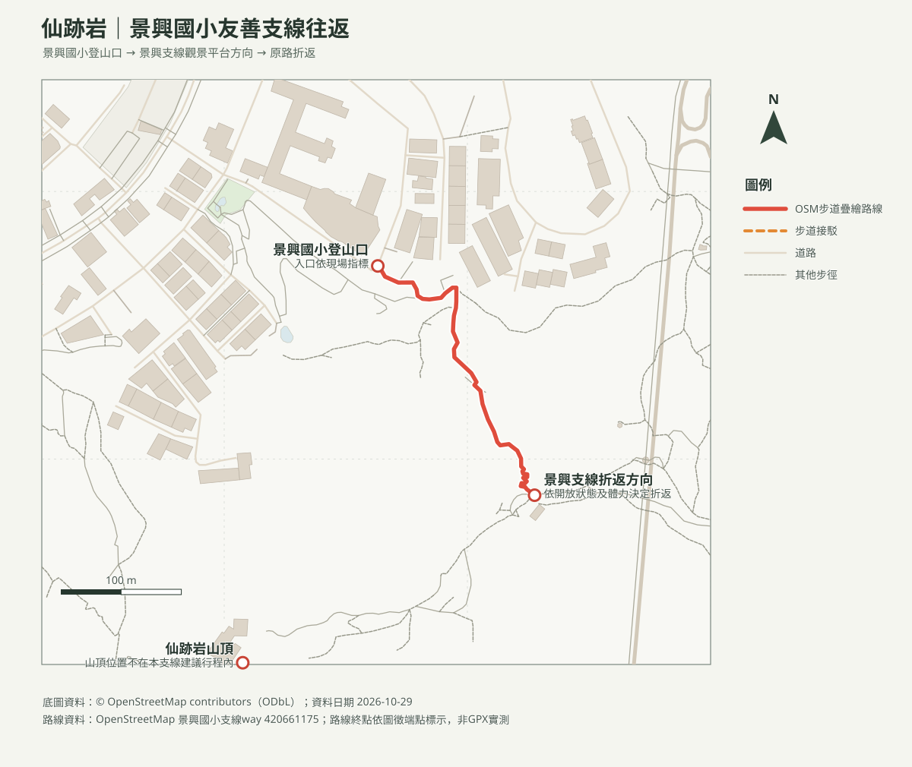
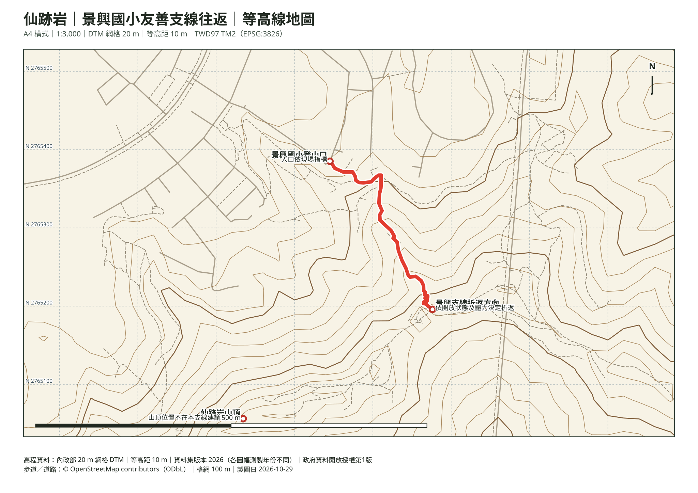

# 2026/11/22（日）仙跡岩景興支線｜行程草案（集合時間待確認）

> **安全提醒：** 景興支線有石階及上坡，雨後容易濕滑；遇雷雨、豪雨、步道封閉或視線不佳，取消或縮短。依現場指標走公共步道，不進入景興國小校園、不走未確認支線，也不為趕團追路。

## 同行與目標
- **活動日期：** 2026-11-22（星期日）。
- **集合時間／確切集合點：** 尚待確認；暫以景興國小後方的公共步道入口為路線起點，請勿入校。集合資訊確認後再更新實際離家門檻。
- **同行預設：** 兩位成人、一位幼兒，同行及照顧安排以當次確認為準。活動日年齡僅放入本機私密 Word，不寫入公開 Markdown。<!-- WORD_PRIVATE_CHILD_AGE -->
- **目標：** 從景興支線入口上行至景觀平台／安全休息點後原路折返；不延伸仙跡岩主峰或其他支線，預留約2–3小時含休息與照護。
- [目的地路線及安全資料](../../口袋名單/目的地/仙跡岩景興支線/README.md)

## 路線總覽與地圖
- 官方資訊指出景興支線位於景興國小後方，近年改善石階、欄杆、景觀平台及涼亭；但未公布此支線專屬距離、爬升或單程步行時間。本次未持有GPX，不列精確里程與累積爬升。
- 下列時間為路線圖資判讀的粗估；一般步行估時以家庭排程乘2，再另加休息及幼兒照護。若實際步道長度或領隊路線不同，按現場指標修正。

- [含路線等高線圖 PDF](../../口袋名單/目的地/仙跡岩景興支線/仙跡岩景興支線_等高線圖.pdf)：20 m網格DTM計算10 m等高距，非10 m地形解析度。
- [仙跡岩周邊方位判讀 PDF](../../口袋名單/目的地/仙跡岩景興支線/仙跡岩景興支線_山頂方位圖.pdf)：觀測點在仙跡岩山頂，不是景興支線路上；真／磁方位及可見性受地形與天候影響。

## 分段路線與時間
1. **集合點 → 景興支線公共入口**：以景興國小後方公共道路入口為暫定起點；依現場指標行走，不入校園。集合與步行接駁時間待確切集合位置確認。
2. **入口 → 景興支線景觀平台／安全折返點**：石階上行；一般步行約20–35分鐘（粗估、非官方時間），家庭排程40–70分鐘。若背負幼兒時石階濕滑、成人負重不穩或幼兒不適，提早折返。
3. **平台 → 原路返回入口**：一般步行約20–35分鐘（粗估），家庭排程40–70分鐘；另預留休息、拍照、餵食／換尿布約30–45分鐘。
- **整體窗口：** 從開始走到回入口約2–3小時；不含住家交通。不是步道實測時間。

## 交通與停車
- **大眾運輸優先：** 捷運松山新店線景美站，依臺北市大地工程處指引步行約10分鐘到景興支線入口；實際出口及會合點待主辦確認。
- **自駕：** 景興公園及周邊巷弄停車空間有限；停車位置、費率與空位未由官方確認，不保證有位。勿違停、勿堵住校門或住戶出入口。若找不到合法車位，改搭大眾運輸或取消，不在巷內繞行等待。
- [景美站到景興支線導航](https://www.google.com/maps/search/?api=1&query=%E6%99%AF%E8%88%88%E5%9C%8B%E5%B0%8F%E5%BE%8C%E6%96%B9%E6%AD%A5%E9%81%93%E5%8F%A3)

## 餐食與裝備
- 早餐出門前吃；自備水與幼兒補給。若停留超過午餐時段，再依主辦集合與散隊時間安排自備餐；本次不查餐廳。
- 防滑鞋、飲水、雨具及幼兒背負用品。支線有階梯，不以嬰兒車通行；背負裝備須符合產品規範並由成人評估負重及下階平衡。

## ABCD 延誤方案（待集合時間確認後換算）
集合時間及地點尚未確認，先以集合時間 **M**、住家至集合點門到門交通時間 **T** 表示；離家時間依即時導航換算，不套用未確認的固定車程。

| 方案 | 目標抵達／離家換算 | 執行內容 | 回程安排 |
|---|---|---|---|
| A | M−15分鐘前抵達；離家不晚於 M−15分−T | 步道開放且天候適合，走到景觀平台後原路折返。 | 開始步行後約2–3小時回到入口，含休息與照護。 |
| B | M−15至M抵達；離家約 M−15分−T 至 M−T | 正常參加；縮短平台停留，不壓縮幼兒照護時間。 | 依團體節奏原路返回。 |
| C | M至M+15分鐘才到；離家約 M−T 至 M+15分−T | 只有領隊確認仍可安全會合時，走短段至最近安全點即折返；不追團。 | 提前返回入口。 |
| D | 預計 M+15分鐘後抵達、集合資訊未確認、封閉或天候不佳 | 取消戶外行程，改室內活動；不自行進入步道追隊伍。 | 不進入封閉或未核實支線。 |

## 硬性折返與行前確認
- **折返原則：** 預估開始步行後2–3小時回入口；若集合後進度落後，取消觀景平台停留或提早折返，不把短線延長成午後行程。領隊若另訂散隊／回程時間，需以領隊確認為準。
- 出發前24小時及當日確認中央氣象署天候、臺北市大地工程處步道公告、實際集合點與停車／交通方案；不確定是否開放或遇雨濕滑即取消。

## 來源與待確認
- [臺北旅遊網：秋高氣爽登仙蹤！漫遊仙跡綠意境](https://www.travel.taipei/zh-tw/news/details/68227)：景興支線位置、步道改善及捷運景美站步行資訊，發布2026-10-21。
- [臺北旅遊網：仙跡岩親山步道](https://www.travel.taipei/zh-tw/attraction/details/186)：仙跡岩整體資訊，非景興支線專屬里程。
- [臺北市大地工程處步道公告](https://www.geo.gov.taipei/)：出發前確認封閉及施工狀況。
- **待確認：** 集合時間、集合位置、同行及幼兒照顧分工、是否自駕。確認後更新本頁與實際離家時間。
